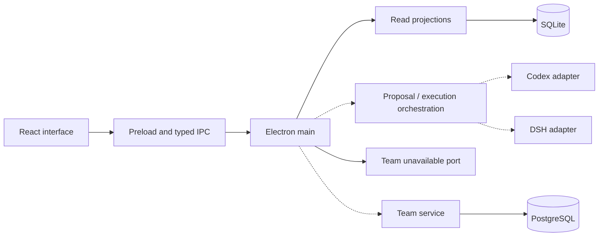
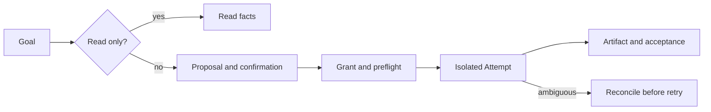
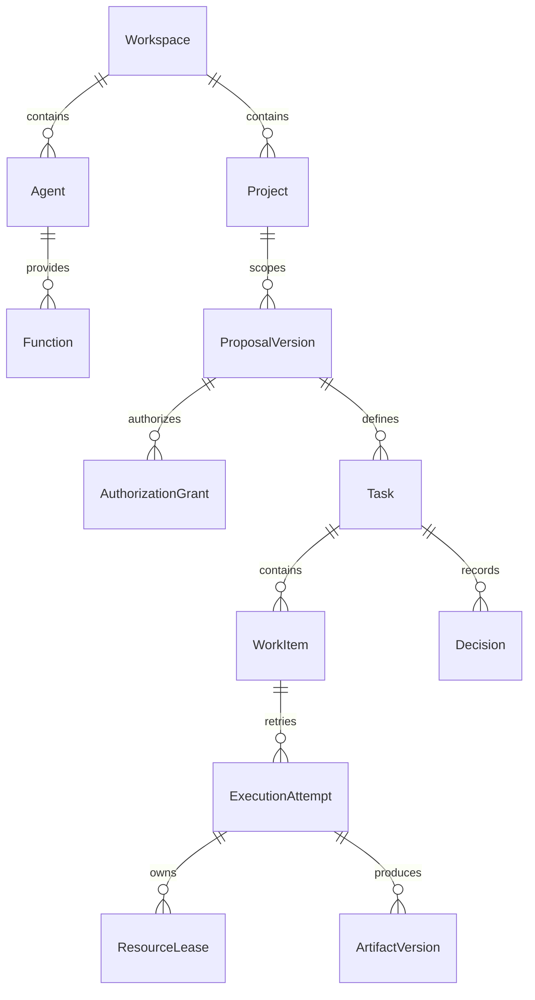

# Integration architecture and acceptance status

Snapshot: 2026-11-04; based on `4984e02` and the separate, uncommitted
TASK-716 worktree. Solid arrows are connected in the entry point; dashed arrows
represent modules or intended integration, not verified end-to-end capability.

The flow above is the intended user contract; current desktop entry points do
not yet demonstrate the complete flow. H1, H2 and H3 integrated acceptance are
not established by historical phase labels.

ER associations describe the business model; they are not a claim that every
association is enforced by a database foreign key.
